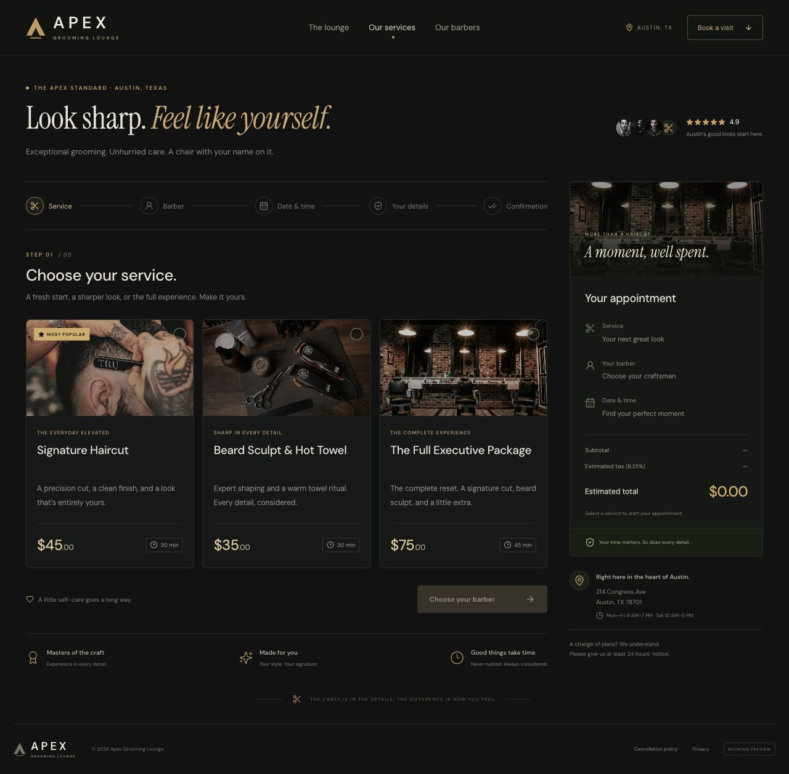

# Apex Grooming Lounge

A premium barbershop booking experience for Austin, Texas. A dark charcoal interface, warm brass accents, and thoughtful interactions guide customers from choosing a service to adding their appointment to a calendar.

Built with **React 19**, **TypeScript**, **Tailwind CSS 4**, **Vite**, **Lucide**, **React Hook Form**, and **Zod**.



## Features

- **Five-step booking:** choose a service, select a barber, find a date and time, enter contact details, and review the confirmation.
- **Live appointment summary:** edit previous choices and see the subtotal, estimated 8.25% Texas sales tax, and total update immediately.
- **US localization:** USD pricing, MM/DD/YYYY dates, 12-hour AM/PM times, and `(555) 000-0000` phone formatting.
- **Austin scheduling:** Central Time, daylight saving support, Sunday closures, a 30-minute lead time, and checks for appointment duration, closing hours, and overlapping reservations.
- **Validated forms:** required contact fields, clear inline errors, optional notes, and drafts preserved when navigating between steps.
- **Payment options:** pay in shop or select a sample card in the Stripe-style payment preview.
- **Calendar exports:** Google Calendar event links and Apple/Outlook-compatible `.ics` downloads with accurate start and end times.
- **Responsive and accessible:** mobile layouts, keyboard navigation, visible focus states, native dialogs, and reduced-motion support.
- **Privacy-conscious storage:** anonymous appointment slots are kept locally; contact details remain in memory and are cleared on reload.
- **Self-hosted assets:** fonts and images ship with the application.

## Getting started

Requirements: **Node.js 22.12+** and **pnpm 11.25.0**.

```sh
git clone https://github.com/inzhusalim/apex-grooming-lounge.git
cd apex-grooming-lounge
pnpm install --frozen-lockfile
pnpm dev
```

Open the local URL printed by Vite.

| Command | Description |
| --- | --- |
| `pnpm dev` | Start the development server |
| `pnpm test` | Run the booking, validation, localization, and calendar tests |
| `pnpm build` | Check TypeScript and generate the optimized build |
| `pnpm preview` | Preview the production build locally |

## Deploy to Vercel

Import this repository into Vercel and use the **Vite** preset. `vercel.json` specifies the build command, pinned package manager, and `dist` output directory. No environment variables are required.

## Project structure

```text
src/
├── App.tsx                         # Booking flow, navigation, and confirmation
├── components/
│   ├── AppointmentSummary.tsx      # Service details and live pricing
│   ├── BookingSteps.tsx            # Service, barber, calendar, and time selection
│   └── ContactForm.tsx             # Contact validation and payment choices
├── lib/
│   ├── booking.ts                  # Scheduling, formatting, storage, and exports
│   └── booking.test.ts             # Booking rules and localization tests
├── main.tsx
└── styles.css                      # Responsive styling and design tokens
```

## Booking and payment scope

This application demonstrates the complete client-side booking flow. Reservations are stored in the current browser rather than a shared database. Payment choices and SMS preferences are previews; no payment is processed and no email or text message is sent. Shop details and barber profiles are sample content.

For live appointments, connect booking submission and availability to a backend with atomic reservation checks. Integrate Stripe Elements and SetupIntents for card storage and a notification provider for confirmations and reminders. The displayed tax rate is configurable; apply the business's actual tax treatment before accepting live bookings.

## Quality checks

The test suite covers tax rounding, US date and time formats, phone masking, contact validation, Austin date boundaries, Sunday closures, same-day lead time, appointment overlaps, Saturday closing hours, fully booked dates, daylight saving time, and calendar file formatting.

## Asset credits

Photography is used under the [Unsplash License](https://unsplash.com/license). **DM Sans** and **Instrument Serif** use the SIL Open Font License; their license files are included in `public/fonts/`.
